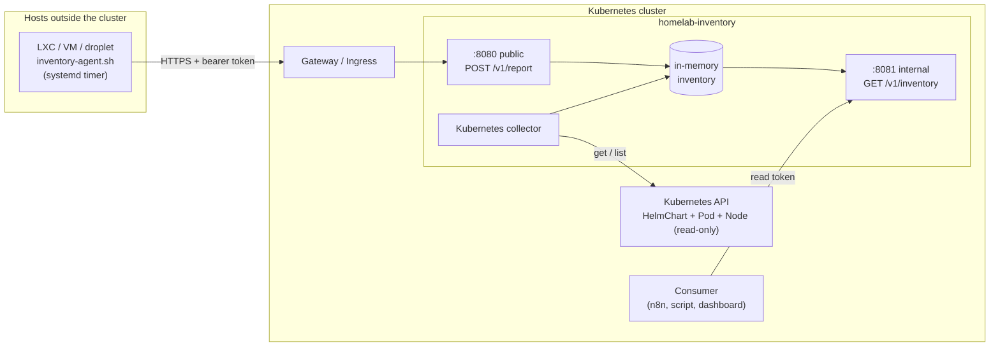
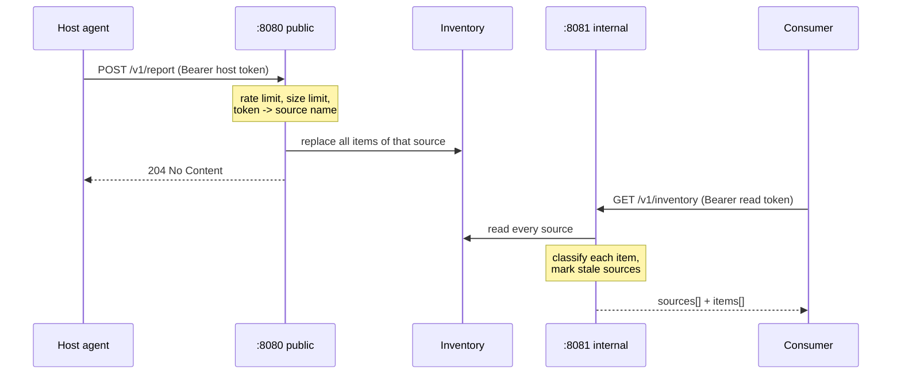
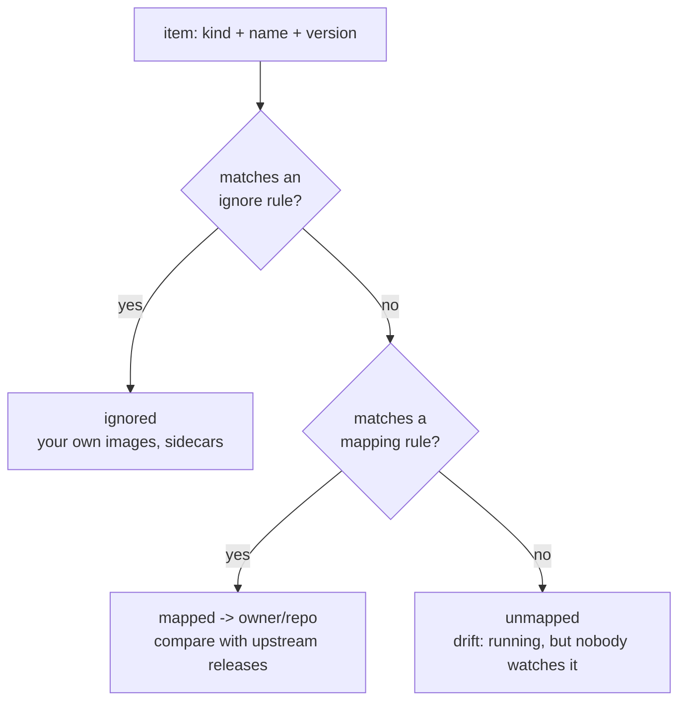
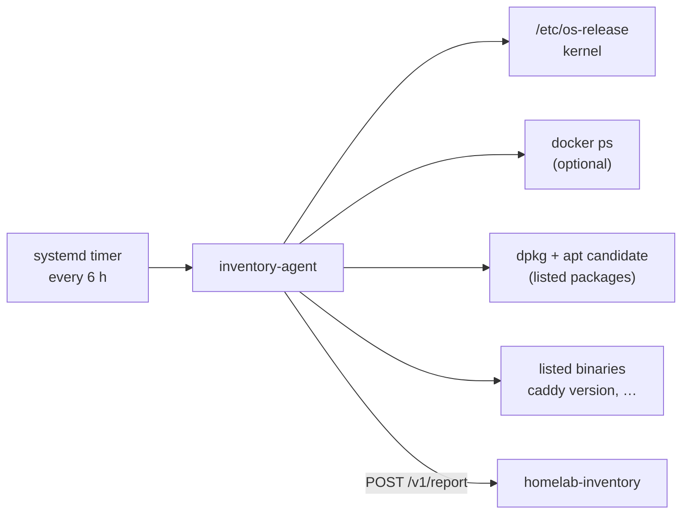

# homelab-inventory

A small service that answers one question: **what version of what is running where**.

Hosts push their versions, the Kubernetes cluster is scraped, and one internal endpoint returns the whole
inventory with every item mapped to its upstream repository. A release notifier, a CVE filter or a dashboard
can then work from a single list instead of a hand-maintained one.

## How it works



Only port `8080` is published. The inventory endpoint lives on a separate listener, so keeping it private is
a property of the deployment (no route to `8081`), not of a path rule that can be mistyped.

### A report, end to end



A report always carries the complete picture of its host and replaces the previous one, so a component that
was removed disappears by omission. The source name comes from the token, never from the body: a host can
only ever write its own data.

### What each item turns into



Two kinds of drift come out of the same response:

| Signal | Meaning |
|--------|---------|
| item with `"status": "unmapped"` | something runs that has no upstream mapping and is not ignored |
| source with `"stale": true` | a configured source has not reported within `stale_after`, or never did |

## API

### `POST /v1/report` (public listener)

```bash
curl -H "Authorization: Bearer $HOST_TOKEN" -H 'Content-Type: application/json' \
  -d '{"items":[{"kind":"docker","name":"ghcr.io/example/app","version":"1.4.2"},
                {"kind":"package","name":"openssl","version":"3.0.13-0","available":"3.0.15-0"},
                {"kind":"kernel","name":"linux","version":"6.8.0-45-generic"}]}' \
  https://inventory.example.com/v1/report
```

| Field | Required | Notes |
|-------|----------|-------|
| `kind` | yes | `docker`, `package`, `kernel`, `os` or `binary` |
| `name` | yes | image repository, package name, … |
| `version` | yes | what is installed now |
| `available` | no | the version the host itself can upgrade to (the apt candidate); useful where no upstream repository exists |
| `ref` | no | free-form pointer, e.g. a compose project |

Returns `204`. Limits: 256 KiB body, 1000 items, 256 characters per field, 30 requests per minute per client.
A missing, malformed or unknown token always gets the same `401`.

### `GET /v1/inventory` (internal listener)

```json
{
  "generated_at": "2026-01-01T12:00:00Z",
  "sources": [
    { "name": "host-a", "last_seen": "2026-01-01T11:40:00Z", "stale": false, "items": 3 },
    { "name": "k8s",    "last_seen": "2026-01-01T11:55:00Z", "stale": false, "items": 42 },
    { "name": "host-b", "last_seen": null, "stale": true, "items": 0 }
  ],
  "items": [
    { "source": "k8s", "kind": "chart", "name": "cert-manager", "version": "1.16.0",
      "ref": "system/cert-manager", "repo": "cert-manager/cert-manager", "status": "mapped" },
    { "source": "host-a", "kind": "docker", "name": "ghcr.io/example/app", "version": "1.4.2",
      "status": "unmapped" }
  ]
}
```

The Kubernetes collector reports kinds of its own:

| Kind | One item per | `name` | `ref` |
|------|--------------|--------|-------|
| `chart` | k3s `HelmChart` | chart name | `namespace/name` |
| `image` | distinct `repository:tag` among pods that are not finished | image repository | a pod that runs it |
| `kubelet` | distinct kubelet version | `k3s`, `rke2` or `kubernetes` | a node that runs it |
| `kernel` | distinct node kernel version | `linux` | a node that runs it |

## Configuration

One JSON file, path in `INV_CONFIG` (default `/etc/homelab-inventory/config.json`). See
[`config.example.json`](config.example.json).

| Key | Meaning |
|-----|---------|
| `sources[]` | reporters: `name` and `token_sha256` |
| `read_token_sha256` | hash of the token that may read the inventory |
| `stale_after` | how long a source may stay silent, default `36h` |
| `kubernetes` | `enabled`, `source` (default `k8s`), `interval` (default `15m`) |
| `mappings[]` | `kind` (optional), `name`, `repo` — first match wins |
| `ignore[]` | `kind` (optional), `name` — checked before mappings |

`name` accepts `*` for any run of characters, slashes included: `*/n8nio/n8n`, `ghcr.io/example/*`.

The file holds token **hashes** only, so it can live in a ConfigMap. Generate a token and its hash:

```bash
TOKEN=$(openssl rand -hex 32); echo "token: $TOKEN"
printf '%s' "$TOKEN" | sha256sum | cut -d' ' -f1
```

| Environment | Default | Meaning |
|-------------|---------|---------|
| `INV_PUBLIC_ADDR` | `:8080` | report listener |
| `INV_INTERNAL_ADDR` | `:8081` | inventory listener |
| `INV_TRUST_FORWARDED_FOR` | `false` | rate-limit by `X-Forwarded-For` when behind a gateway |

## Install

[`deploy/kubernetes.yaml`](deploy/kubernetes.yaml) holds everything the service needs — ServiceAccount,
ClusterRole and binding, ConfigMap, Deployment and Service:

```bash
kubectl create namespace homelab-inventory
kubectl -n homelab-inventory apply -f deploy/kubernetes.yaml
```

Put your token hashes into its ConfigMap first, and publish only the `report` port.

## Kubernetes permissions

The collector reads the API with the pod's ServiceAccount and needs nothing beyond this:

```yaml
apiVersion: rbac.authorization.k8s.io/v1
kind: ClusterRole
metadata:
  name: homelab-inventory
rules:
  - apiGroups: [""]
    resources: ["pods", "nodes"]
    verbs: ["get", "list"]
  - apiGroups: ["helm.cattle.io"]
    resources: ["helmcharts"]
    verbs: ["get", "list"]
```

`nodes` is optional: without it the collector still reports charts and images and logs that nodes were
skipped. Set `kubernetes.enabled` to `false` to run it as a plain push-only inventory.

## Host agent

`inventory-agent` is a single static binary: it collects, sends one report and exits. Each release
carries it for `linux/amd64` and `linux/arm64` together with `SHA256SUMS`.



| Reported as | Source | Enabled by |
|-------------|--------|------------|
| `os` | `/etc/os-release` | always |
| `kernel` | running kernel | always |
| `docker` | images of running containers | `"docker": true` |
| `package` | installed version, plus `available` when apt has a newer candidate | `"packages": [...]` |
| `binary` | a version parsed from the command's output | `"commands": [...]` |
| `binary` `inventory-agent` | the agent itself | always |

A source that cannot be read is skipped with a line on stderr; everything else is still sent.

Install, with the files from [`deploy/agent/`](deploy/agent/):

```bash
install -m 0755 inventory-agent_<version>_linux_amd64 /usr/local/bin/inventory-agent
install -d -m 0700 /etc/homelab-inventory-agent
install -m 0600 config.json token /etc/homelab-inventory-agent/
install -m 0644 inventory-agent.service inventory-agent.timer /etc/systemd/system/
systemctl daemon-reload && systemctl enable --now inventory-agent.timer
```

The agent refuses to start when its config is writable by group or others, or owned by someone other
than root or the user running it: the file lists commands that the agent executes, usually as root. It
also refuses a plain `http://` report URL unless the host is loopback, so the token never travels
unencrypted.

`inventory-agent -dry-run` prints the report instead of sending it. For a command, `pattern` is a regular
expression whose first group is the version; without it the first `x.y.z` in the output is used.

## State

There is no database. The inventory is held in memory and rebuilds itself after a restart: the collector
scrapes again at once and every host reports on its next timer run. Until then a host shows up as `stale`.

## Development

```bash
go test ./...
go build ./cmd/homelab-inventory
```
